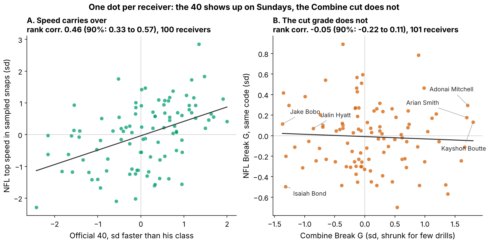

# Don't Dock a Receiver for a Soft Combine Cut

**Scouts grade "sink and burst" off the Combine route drills, and clubs pay for it. We measured that cut on every tracked rep and on the same men's NFL breaks. A hard drill plant does not make a receiver more open on Sundays: one sd of drill Break G moves separation over expected by {full_b} inches (90% interval {full_b_lo} to {full_b_hi}; {n_soe} receivers, each class scored by a forecast fit on the other two). The usable side is the other end: the softest-cutting third of each class goes {soft_pick_gap} picks later yet is {soft_gap} inches more open than the rest, relative to forecast ({soft_lo} to {soft_hi}). A soft drill cut is not a reason to pass on a receiver.**

**Break G** measures how hard a receiver plants: his average g-force over the one second around his first real cut, covering the brake into the cut, the turn and the drive out. On film it reads as three speeds: into the break, at the plant and out of it. A typical NFL hitch break is {hitch_bg_nfl} g; the same break in the Combine hitch drills is {hitch_bg_drill} g.

**Why it matters.** At the same 40, weight, NGS score and position, a receiver 1 sd higher in Break G goes {price}% earlier in pick number (90% interval {price_lo} to {price_hi}; {n_drill} receivers). If the grade does not carry, the men it marks down are a discount.

**Data**
- **Combine:** {n_reps} tracked reps in ten route drills (2023–2025 classes), {n_cuts} with a gradable cut, each scored against the same drill and year.
- **NFL:** the same code on {n_nfl_breaks} sampled regular-season breaks by {n_nfl_rec} receivers, in the five route families the drills copy (slant, out, hitch, in, corner).
- **Outcome:** separation over expected (SOE), inches more open at the throw than Next Gen Stats separation predicts from alignment, cushion, position and season. Full regular seasons ({n_pseason} player-seasons, median {med_routes} career routes), not the tracking sample.

## 1. The drill asks for a different cut

On the hitch family he enters at {hitch_in_drill} yd/s (about {hitch_in_drill_mph} mph) in the drill and {hitch_in_nfl} yd/s (about {hitch_in_nfl_mph} mph) in the NFL. Drill entry is faster in all {n_fam_faster} families, and only {share_nfl_at_drill}% of NFL breaks are entered as fast as a typical drill rep. Because Break G rises with entry speed (rank correlation {rho_bg_vin_drill} in drills, {rho_bg_vin_nfl} in games), the drill mostly rewards stopping from a speed NFL routes rarely use.

## 2. Speed carries; the cut does not

The control works: a receiver's official 40 ranks with his NFL top speed at {f40_rho} (90% interval {f40_lo} to {f40_hi}; {f40_n} receivers). The cut does not: drill Break G vs NFL Break G is {rec_rho} ({rec_lo} to {rec_hi}; {rec_n} receivers). Both measures are noisy, but a true link of {link} would still read about {true05}. Across {n_cells} route-family-by-component cells ({pair_n} receiver-family pairs), the best is braking into the plant at {all_decel}; corrected for the search by shuffling, its p-value is {brk_adj_p}.

## 3. Break G adds nothing to a no-tracking forecast

The test was fixed in advance: fit on two draft classes, score the third, rotate, weight by routes; ±3 inches per sd is the smallest effect a club would act on. Intervals resample whole receivers and refit every step. All intervals in this paper are 90%.

| No-tracking forecast | Its held-out R² | R² change adding Break G [90%] | Break G effect, inches per sd [90%] |
|---|---|---|---|
| Pick only | {pick_r2} | {pick_dr2} [{pick_dr2_lo}, {pick_dr2_hi}] | {pick_b} [{pick_b_lo}, {pick_b_hi}] |
| Pick + role (TE, slot share) | {role_r2} | {role_dr2} [{role_dr2_lo}, {role_dr2_hi}] | {role_b} [{role_b_lo}, {role_b_hi}] |
| Ridge: pick, 40, weight, NGS, TE, slot | {ridge_r2} | {ridge_dr2} [{ridge_dr2_lo}, {ridge_dr2_hi}] | {ridge_b} [{ridge_b_lo}, {ridge_b_hi}] |
| **Pick + 40, weight, NGS, TE** (set in advance) | {full_r2} | {full_dr2} [{full_dr2_lo}, {full_dr2_hi}] | **{full_b} [{full_b_lo}, {full_b_hi}]** |

*Table 1. {n_soe} receivers with a drill score and NFL separation. An R² below zero means the forecast does worse on a new class than that class's own average.*

Career SOE varies by {sd_soe_in} inches between receivers; draft slot plus testing explains none of it on a new class, and Break G does not help under any forecast. All three classes lean slightly negative: 2023 {cls2023_b}, 2024 {cls2024_b}, 2025 {cls2025_b} inches per sd (Figure 3A). Stress tests agree:

- **Shuffle placebo.** Shuffling Break G within class {n_shuffle} times, the one-sided p-value for "harder cutters are more open" is {plac_p1}.
- **Same team, same quarterback.** Resampling whole teams ({n_teams}) gives {team_b_lo} to {team_b_hi}.
- **Coverage.** Man-coverage share is unrelated to season SOE ({man_share_rho}); adding it to the expected-separation model leaves {cov_b} ({cov_lo} to {cov_hi}).
- **Availability.** Keeping only seasons of 10+ games, a crude injury filter, gives {hlth_b} ({hlth_lo} to {hlth_hi}; {hlth_n} receivers); with both changes, {both_b}.
- **No tracking.** The official 3-cone ({cone_b} in per sd, {cone_n} receivers) and short shuttle ({shut_b}, {shut_n}) say the same.

## 4. The draft-room view: soft cutters are a discount

Boards use tiers, not slopes. Split each class into thirds by drill Break G (Figure 3B). The softest third ({soft_n} receivers) went at a median pick of {soft_pick}, against {rest_pick} for the rest. On held-out separation they beat the no-tracking forecast by {soft_gap} inches more than the rest ({soft_lo} to {soft_hi}), and {soft_beat}% of them beat their own forecast against {rest_beat}% of the others. Only {soft_nworse} of {n_shuffle} bootstrap resamples put them 3 or more inches worse, the smallest gap that would justify marking them down. Among day-3 and undrafted receivers alone ({soft3_n} soft vs {soft3_nrest} others) the gap is {soft3_gap} ({soft3_lo} to {soft3_hi}), too noisy to claim but pointing the same way.

This is the testable prescription, frozen in `frozen_rule.json` before the 2026 class has a snap: score the 2026 class with the same code; through 2027 the soft third will trail the rest by less than 3 inches of SOE minus forecast, and the hard third will not lead by 3 or more. Either failure, with a 90% interval excluding zero, falsifies this paper.

## 5. Named receivers, chosen by rule

| Receiver (class, pick; drill rank of {n_elig}) | Combine in → plant → out, yd/s (g) | NFL, same families (g) | Career SOE, in [90%] (routes) | Clip to pull (play log) | Read |
|---|---|---|---|---|---|
| {h1_name} ({h1_year}, {h1_draw}; #{h1_rank}) | {h1_din} → {h1_dap} → {h1_dout} ({h1_dg}) | {h1_nin} → {h1_nap} → {h1_nout} ({h1_ng}) | {h1_soe} [{h1_soe_lo}, {h1_soe_hi}] ({h1_routes}) | {h1_clip}; {h1_clip_sep} yd open, {h1_clip_log} | Hardest drill planter; sheds {h1_nmph} mph into Sunday breaks vs {h1_dmph} at Indy. Average separation. |
| {h2_name} ({h2_year}, {h2_draw}; #{h2_rank}) | {h2_din} → {h2_dap} → {h2_dout} ({h2_dg}) | {h2_nin} → {h2_nap} → {h2_nout} ({h2_ng}) | {h2_soe} [{h2_soe_lo}, {h2_soe_hi}] ({h2_routes}) | {h2_clip}; {h2_clip_sep} yd open, {h2_clip_log} | Second-round pick; ordinary Sunday plant ({h2_nbg} sd), average separation. |
| {h3_name} ({h3_year}, {h3_draw}; #{h3_rank}) | {h3_din} → {h3_dap} → {h3_dout} ({h3_dg}) | {h3_nin} → {h3_nap} → {h3_nout} ({h3_ng}) | {h3_soe} [{h3_soe_lo}, {h3_soe_hi}] ({h3_routes}) | {h3_clip}; {h3_clip_sep} yd open, {h3_clip_log} | Near-dead stop in drills, ordinary Sunday cut ({h3_nbg} sd), wide open. The space is not coming from the plant. |
| {s3_name} ({s3_year}, {s3_draw}; #{s3_rank}) | {s3_din} → {s3_dap} → {s3_dout} ({s3_dg}) | {s3_nin} → {s3_nap} → {s3_nout} ({s3_ng}) | {s3_soe} [{s3_soe_lo}, {s3_soe_hi}] ({s3_routes}) | {s3_clip}; {s3_clip_sep} yd open, {s3_clip_log} | Rounds drill cuts at speed (sheds {s3_dmph} mph); on Sundays he sits down hard on hitches and is slightly open. |
| {s2_name} ({s2_year}, {s2_draw}; #{s2_rank}) | {s2_din} → {s2_dap} → {s2_dout} ({s2_dg}) | {s2_nin} → {s2_nap} → {s2_nout} ({s2_ng}) | {s2_soe} [{s2_soe_lo}, {s2_soe_hi}] ({s2_routes}) | {s2_clip}; {s2_clip_sep} yd open, {s2_clip_log} | Undrafted, softest Sunday cut of the six ({s2_nbg} sd), above-expected separation. The case for not docking. |
| {s1_name} ({s1_year}, {s1_draw}; #{s1_rank}) | {s1_din} → {s1_dap} → {s1_dout} ({s1_dg}) | {s1_nin} → {s1_nap} → {s1_nout} ({s1_ng}) | {s1_soe} [{s1_soe_lo}, {s1_soe_hi}] ({s1_routes}) | {s1_clip}; {s1_clip_sep} yd open, {s1_clip_log} | Softest drill cutter, undrafted, ordinary Sunday cut, near-average separation on a real workload. |

*Table 2. Medians over route families he ran in both settings. The clip is his random-sample break closest to his own NFL median, with the official play result, so a scout can pull the snap. Reads come from tracking and the play log; we have not watched the film.*

Every one of the six plants softer on Sundays than at Indianapolis (Table 2, g), and the hard and soft ends converge on the league average (Figure 4, bottom). Only Smith's separation interval excludes zero, and he is a hard cutter whose Sunday cut is ordinary.

## 6. What to do on Monday

- **Draft room:** do not move a receiver up the board, or down it, for his route-drill cut grade. In 2026 expect about {t3_per_class} soft-third names per class; when one is on the day-3 board with a fine 40, treat the soft cut as noise and take the discount. Pay for the 40, which does carry.
- **Scouts:** grade the Sunday tape over the drill plant; Table 2 shows how to pull the clip.
- **Combine staff:** re-stem the curl, comeback and hook at NFL hitch entry speed (about {hitch_in_nfl} yd/s, a controlled three-quarter stem) and grade at least {cuts70} cuts per receiver.
- **Position coaches:** rep breaks at game tempo; nothing here says a harder full-speed plant buys separation.

## Limitations

- **Not blind.** All three classes were seen in earlier rounds. The Break G definition, the ±3 inch margin and the pre-set forecast were frozen before these tests; the ridge row, team bootstrap, placebos, coverage and availability checks and the thirds view came afterwards. The 2026 rule is the first truly out-of-sample test.
- **Power.** A true +3 inch effect would be detected {sim_pow3}% of the time (appendix). Harm down to {full_b_lo} inches per sd is not excluded, and the soft-third discount rests on {soft_n} men.
- **Tracking is a sample.** Up to 40 NFL plays per player, half top-EPA, no defenders or ball; Sections 3 and 4 use full-season NGS separation instead. On random snaps only, drill vs NFL Break G is {rand_rho} ({rand_lo} to {rand_hi}; {rand_n} receivers).
- **Controls are coarse.** Coverage enters as a season man share, not per snap; injuries only as a games filter; scheme and quarterback only through team resampling.
- **Selection and outcome.** Only {n_soe} of {n_drill} drill-scored receivers logged NFL routes. SOE leaves out contested catches, yards after catch and earning targets.

## Appendix: method, reliability and power

A cut is the first turn of 30° or more after {def_path} yd of stem, entered above {def_entry} yd/s. Positions are Savitzky–Golay smoothed at 10 Hz, and Break G averages acceleration magnitude over ±{def_hw} s around the turn. A receiver's score averages his drills (z-scored within drill and year), shrunk toward the mean by between-drill reliability. NFL breaks are z-scored within route family and position.

A single graded cut has reliability {rel_rep}. At the median of {med_cuts} cuts per receiver the score's reliability is {rel_med}; {cuts70} cuts would reach {rel70}. Simulating the whole pipeline with real noise and route weights, the slope averages {sim_mean3} when the truth is +3 (no attenuation); its spread under no effect is {sim_sd} inches. {p_rope}% of resampled effects fall inside ±3 inches. `analysis.py` rebuilds every number, table and figure from `data/processed`.
