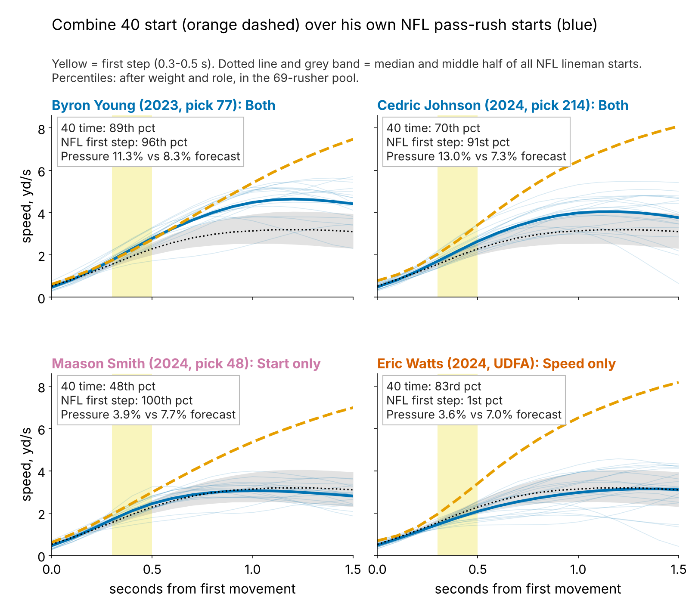
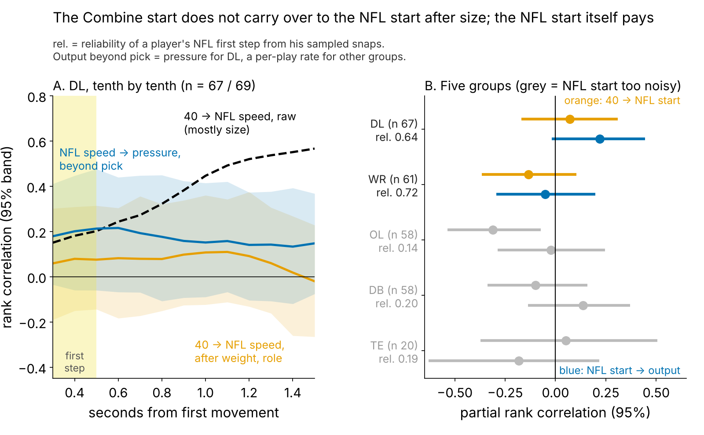
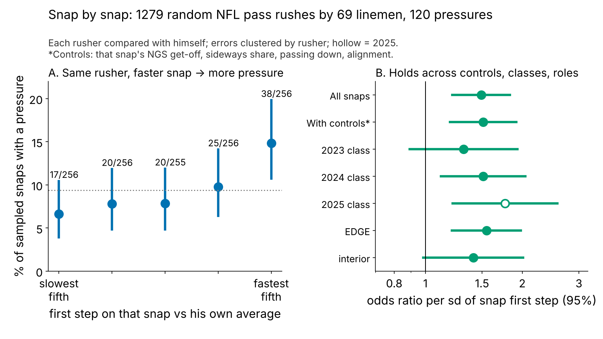
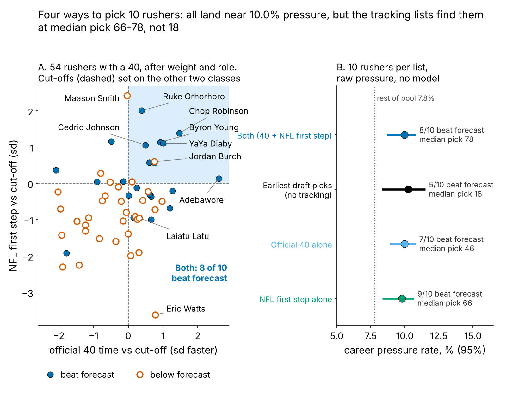
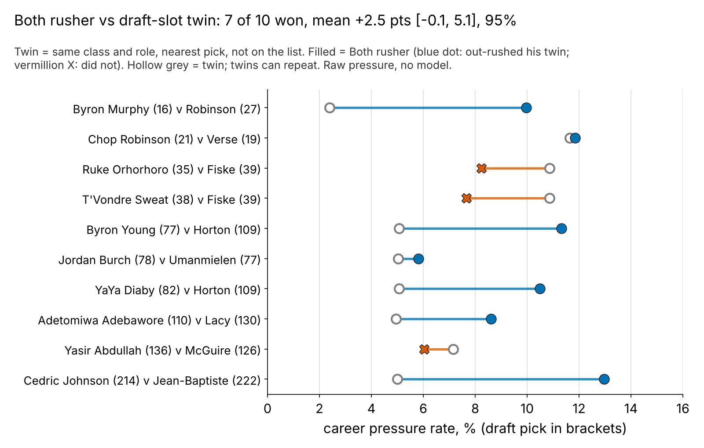

# Does the Combine Start Show Up on Sundays? For Pass Rushers, No. His Own NFL First Step Does.

**We laid each defensive lineman's tracked Combine 40 start over his own random NFL pass-rush starts. After size, the two barely match (ρ = {{tr_fs}}), and none of five drill-to-game similarity scores explains pressure beyond draft slot. What helps, a little, is how fast he is 0.3–0.5 s into about 20 sampled NFL rushes. Rushers fast there tie the pressure rate of their class's earliest picks ({{ls_step_raw}}% vs {{ls_pick_raw}}%) at median pick {{ls_step_pick}}, not {{ls_pick_pick}}.**

## Why pass rushers

A pass rush starts like a 40: from a stance, straight ahead, before anyone touches him. If Combine tracking translates anywhere, it is here. We screened all five groups the same way (Figure 2B). Receivers' NFL starts are readable but do not pay; offensive linemen, defensive backs and tight ends start too inconsistently to read from 20 snaps.

## So what for a team

1. **Pro personnel: chart {{snaps_for_07}}+ random rushes per young rusher and rank by NFL first step** for passing-down snaps and extension film. One sd is worth about {{ht_nfl_season}} pressures a season beyond draft slot (95%: {{ht_nfl_season_lo}} to {{ht_nfl_season_hi}}).
2. **Draft room: trust the stopwatch, not the trace.** The tracked 40 start and every drill-to-game match add nothing beyond pick; the official 40 time does (Table 1).
3. **Names (Table 3):** extend Byron Young (LAR) and YaYa Diaby (TB); re-score Chop Robinson (MIA) at midseason after his 2025 miss. The list is hashed for a 2026 test.

## The metric and the data

**First step** = speed 0.3 to 0.5 s after a lineman first moves, in sd after weight and role. In that window the 40 and a pass rush are the same movement; by 1.5 s they part ({{dr_med_40}} yd/s in the 40, {{dr_med_sunday}} on a rush, because he meets a blocker).

**Combine:** tracked 40s, year-standardized, curves starting at first movement, so the clip's ~0.3 s lead before the laser drops out. **NFL:** only the randomly sampled pass rushes with the player set at the snap (the top-EPA half is never used), alignment-adjusted per snap: {{n_snaps_dl}} starts by {{n_gplayer}} linemen, median {{snaps_med}} each, player reliability {{rel_fs_game}}, ρ = {{rho_fs_ngs_snap}} with NGS get-off snap by snap. **Pool:** of {{x_all}} linemen, {{x_nostarts}} have fewer than 8 sampled starts and {{x_lowrush}} fewer than 100 rushes; {{x_pool}} remain. **Outcome:** career pressures per rush. **Baseline without tracking:** draft pick, weight and EDGE share, fitted on the other two classes and scored on the third; a stronger one adds the official 40 and NGS get-off. All intervals are 95%.

## Finding 1: the drill does not translate

Raw, the 40 ranks NFL speed at 1.5 s at {{tr_raw_15}}, but that is weight: big men are slow in both. After weight and role, his 40 first step previews his NFL first step at ρ = {{tr_fs}} [{{tr_fs_lo}}, {{tr_fs_hi}}] (n = {{n_tr}}). With two reps averaged a perfect link could show {{ceil_2rep}}; a true translation of 0.5 or more has posterior probability {{tr_post05}}.

Five versions of "plays like he tested", none chosen on outcome, go through the same held-out test (Table 1, top). None moves pressure by more than {{st_absmax}} points per sd; every interval spans zero.

{{TABLE:ledger26}}

*Table 1. Pressure-rate points per sd (DL average about 8%); slope per held-out class, pooled by random effects.*

## Finding 2: his NFL first step pays, modestly

The NFL side alone carries {{ht_nfl_pp}} points per sd [{{ht_nfl_lo}}, {{ht_nfl_hi}}] beyond pick, weight and role on held-out classes (within-class shuffle p = {{ht_nfl_p}}; {{ht_nfl_p_adj}} allowing for the best of {{ht_nwin}} time windows). Choosing the window inside each training fold, forecast refit there too, gives {{nw_pp}} [{{nw_lo}}, {{nw_hi}}]. As a ranking it orders pressure over forecast at ρ = {{rq_all}} [{{rq_all_lo}}, {{rq_all_hi}}] for all {{rq_all_n}}, and {{rq_d3}} [{{rq_d3_lo}}, {{rq_d3_hi}}] for the {{rq_d3_n}} day-3 and undrafted men.

It is not a better projection: added to the pick forecast, it moves rank correlation with raw pressure from {{rq_base}} to {{rq_plus}} (gain {{rq_gain}} [{{rq_gain_lo}}, {{rq_gain_hi}}]), in line with public audits that tracking adds about zero R². It flags who beats his slot, not who is good.

**Same rusher, faster snap.** On {{sn_n}} random rushes by {{sn_players}} linemen, a first step one sd faster than *his own* average multiplies that snap's pressure odds by {{sn_or}} [{{sn_or_lo}}, {{sn_or_hi}}]: {{sn_top5}}% on his fastest fifth, {{sn_bot5}}% on his slowest. With that snap's NGS get-off, sideways path, down and alignment fixed it is {{sn_or_ctl}}, so it is not a free-rush or alignment artifact.

## Finding 3: a short list finds production later in the draft

**Rule.** *Both* = NFL first step in the top third and official 40 in the top half, cut-offs from the other two classes. A rusher "hits" if he beats the held-out forecast (base rate {{sl_base}}%).

{{TABLE:robust}}

*Table 2. Five checks on one list. Gap: rushers resampled within class; p: labels shuffled within class.*

The gap narrows in every stricter check. Row 5 is cleanest: called from 2023–24 starts, scored on 2025 against each rusher's own past pressure. As a probability the rule improves Brier score over the base rate by {{br_gain}} [{{br_gain_lo}}, {{br_gain_hi}}].

**What it does not beat (Figure 4B).** On raw pressure, Both ({{ls_both_raw}}%) ties the same number of earliest picks ({{ls_pick_raw}}%; difference {{ls_diff}} points [{{ls_diff_lo}}, {{ls_diff_hi}}]). The NFL first step alone does as well ({{ls_step_k}} of {{ls_step_n}} beat forecast vs {{ls_both_k}} of {{ls_both_n}}), so here the 40 half adds nothing. The value is price: the same pressure from median pick {{ls_both_pick}}, not {{ls_pick_pick}}.

Against his draft-slot twin (same class and role, nearest pick, median {{mp_pickgap}} picks apart, raw pressure, no model), each Both rusher won {{mp_w}} of {{mp_n}} pairs, by {{mp_diff}} points [{{mp_diff_lo}}, {{mp_diff_hi}}]; sign test p = {{mp_p}}. Frozen after 2024 and scored on 2025: {{mpf_w}} of {{mpf_n}}. Wins are larger than losses; the count alone proves nothing.

**Where rule and tape disagree.** Maason Smith (Jacksonville, 2024, pick 48) has the pool's best NFL first step, a {{b_smith_t}}th-percentile 40 and {{b_smith_rate}}% pressure against a {{b_smith_fc}}% forecast: fast off the ball, not winning. Grade hands and a counter before cutting his snaps.

## The 2026 list, frozen

Same rule, cut-offs from all three classes, every lineman with 8+ sampled starts. Bold = act now ({{act_minrush}}+ rushes, a point or more over forecast, available); † = missed {{avail_cut}}%+ of possible games.

{{TABLE:list26}}

*Table 3. Percentiles within the pool; forecast = pick, weight and role, fitted on the other two classes. Last column: the call frozen after 2024, scored on 2025 against his own past pressure.*

Of the 2024 calls scored in 2025, {{rec_hit}} hit and {{rec_miss}} missed (Robinson, below his own strong rookie rate). **Pre-registration:** rule, {{pre_nlist}} names and test frozen in `frozen_rule.json` (sha256 `{{rule_hash}}…`, 24 October 2026, no 2026 data). In 2026, list members with 100+ rushes must beat a persistence forecast more often than the other {{pre_nrest}} (one-sided Fisher p < {{alpha}}). Power: {{pre_pow_obs}}% at the 2025 rates ({{pre_pa}}% vs {{pre_pb}}%), {{pre_pow_half}}% at half the gap; a miss will be reported.

## Limitations

- **The translation null is partly measurement.** One 40 rep is a noisy first step (repeatability {{rel40_fs}}), so a weak true link could hide below the {{ceil_2rep}} ceiling.
- **Not blind until 2026.** The two-signal form was chosen after seeing all three classes; only cut-offs are held out. The 40 half adds nothing over the first step here.
- **Small, sampled tape.** Lists of ten, three on day 3; single-snap reliability {{rel_fs_1snap}}. No blockers or ball: a slow start can be a two-gap call, a fast one a free rush. Window z-scores use all three classes; injuries enter only as missed games.

## Appendix

Re-fits of the headline slope: rusher random-intercept binomial model on {{mm_seasons}} player-seasons, {{mm_pp}} [{{mm_lo}}, {{mm_hi}}]; weighting for reaching the pool (AUC {{sel_auc}}), {{ipw_pp}} [{{ipw_lo}}, {{ipw_hi}}]. Beyond each rusher's own 2023–24 pressure, the frozen first step adds {{tf_pp}} [{{tf_pp_lo}}, {{tf_pp_hi}}] in 2025. Model: two-class forecast as logit offset, quasi-binomial. Nested window starts chosen per held-out class: {{nw_2023_win}}, {{nw_2024_win}}, {{nw_2025_win}} s. Among the {{sel8_n}} with 8+ starts, first-step odds ratio for reaching the pool {{sel_fs_or}} (p = {{sel_fs_p}}).

*Reproduce: `uv run python writeup/candidates/round_26/cand_3/analysis.py` (about 4 minutes).*
