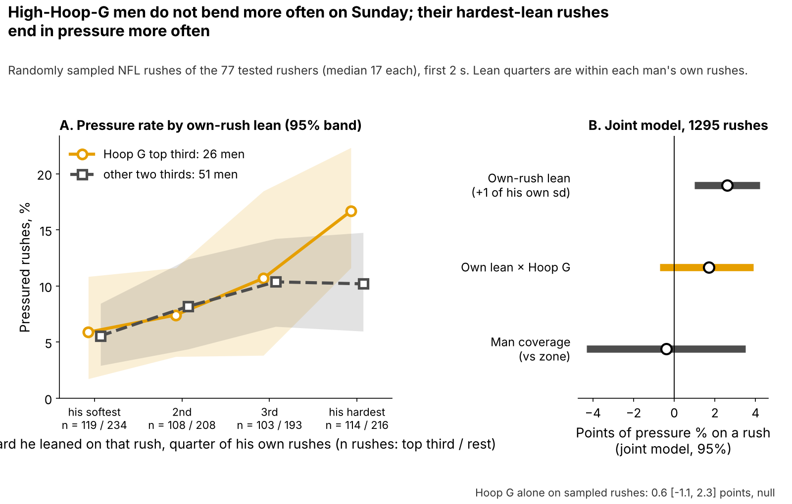
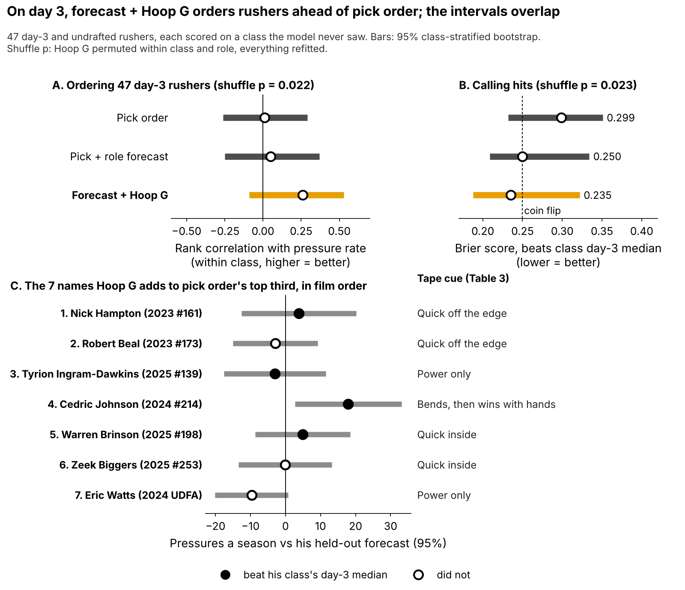
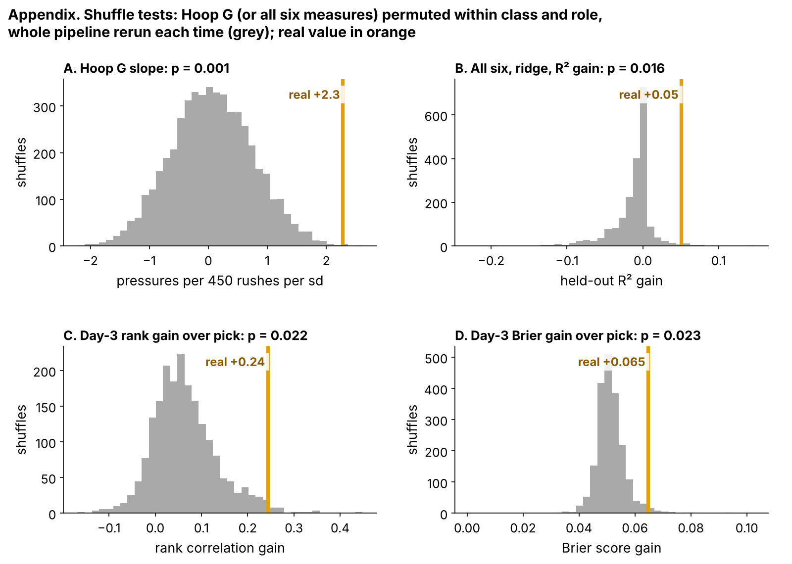

# Day-3 Pass Rushers Who Stay Fast Through the Combine's Tightest Turn Get About 2 More Pressures a Season

Across 77 defensive linemen from the 2023–25 classes, each standard deviation (sd) of **Hoop G** was worth about 2.3 more pressures a season than draft slot and role predicted, measured on classes the model never saw. Hoop G is how fast a man stays while turning tight on the Run-the-Hoop drill, compared with his Combine class. The action: flag each class's top-third day-3 and undrafted linemen on Hoop G and open their tape first.

- **Scout, Monday:** that is about 8 names a class (5–11). Table 3 gives each name a tape cue and a clip to pull.
- **2026 list:** the 2026 class's Combine tracking is not in this release. The frozen rule (`frozen_rule.json`, hash ad1cc734cdd4) prints that list the day the tracking is loaded. Those rookies are already on rosters, so the list orders practice-squad and waiver film, not the draft board.
- **Combine:** grade four hoop laps, not one. A single lap repeats at only 0.43.

The evidence is weak: the 2025 class alone was flat, and the no-selection version of the test has an interval that spans zero.

**Why day 3.** 69% of these 118 linemen went on day 3 or undrafted, where tape is thinnest and clubs find rotational edge rushers. Bend is graded only off tape, and the hoop is the one Combine drill that times it.

## Why the hoop should matter on a rush

An edge rusher who reaches the tackle's outside shoulder has to turn toward the quarterback without slowing down. If he brakes to turn, the tackle recovers and rides him past the pocket. The hoop asks for that turn with no blocker in the way.

*Note on units.* Lean is speed squared over turn radius, in g. On the hoop the median lineman carries 7.1 mph around a 1.8-yard radius (0.62 g). On an NFL rush it is 5.6 mph around 4.1 yards (0.18 g), so men are compared within their class, never in raw g.

**One rep, read off tracking.** Nick Hampton, 2024 week 9, Q4 10:40 against SEA, second-and-4, aligned wide at EDGE with zone coverage behind him. He is off the ball in 0.77 s (lineman median 0.94) and reaches 13.3 mph. When the pressure is logged at 1.8 s he is 5.6 yards upfield and 3.7 yards across. The play log: "(10:40) (No Huddle, Shotgun) G.Smith pass incomplete short left to Z.Charbonnet (N.Hampton)." His hardest lean on that rep is only 0.16 g, around a 14.1-yard arc. That is a speed rush, not a bend, which is why his Table 3 cue is the get-off.

## Does it hold on a class the model never saw?

**Outcome:** career pressure rate through 2025 for linemen with 30+ rushes, shrunk toward the 8.1% mean. **Test:** each class (27/23/27 rushers) is forecast by a model fitted on the other two, with drill measures standardized within Combine year.

| The frozen test (n = 77) | R², pick + role | R², + Hoop G | Hoop G per sd [95%] | Shuffle p |
|---|---|---|---|---|
| **Hoop G vs a pick + role forecast** | 0.10 | 0.16 | **+2.3 [0.7, 4.0]** | 0.001 |

*Table 1. Pressures per 450-rush season. R² = share of rusher-to-rusher spread explained on held-out classes. Shuffle: Hoop G permuted within class and role.*

Hoop G was the best of 6 drill measures we tried. With no choosing, all six go into one shrunk (ridge) model, with the penalty set inside the training classes. Its held-out R² gain is 0.05 [95%: −0.22, 0.18] (shuffle p = 0.016), and 69% of its weight lands on the three hoop measures. Read plainly: the hoop drill carries what signal there is, but it is weak.

Figure 2 puts every check on one scale. The slope holds with wave-drill lean in the model, with the 30 NFL clubs resampled, and with stance, snap load and club pass rush added to the forecast. The weak rows are the 2025 class alone (+0.6 [−1.5, 2.6]) and the 2026 forecast. Spread between classes (sd 1.2) gives a 2026 slope of 2.0 with a 95% prediction interval of [−2.9, 7.0]. The chance its true slope is above zero is 88%.

## Drill to Sunday: the hoop marks who finishes the bend

The hoop does not predict how often a man bends on Sunday: Hoop G's rank correlation with his average NFL rush lean is 0.14. So we fit one joint model of pressure. It combines career pressure counts with 1295 randomly sampled rushes (median 17 a man), and each rusher gets his own random intercept. Every rush carries the defence's man or zone coverage and a long-yardage flag. Hoop G is corrected for its 0.43 single-lap reliability. Each rush's lean is measured against the same man's other rushes, which takes out his size, role and usual blockers.

| Joint model term (95%) | Estimate |
|---|---|
| Rush where he leans 1 of his own sd harder | +2.6 points of pressure [1.0, 4.2] |
| … extra for each sd of Hoop G | +1.7 points [−0.7, 3.9] |
| Hoop G, career pressures a season, noise-corrected | +7.1 [2.7, 12.9] (uncorrected 4.7) |

*Table 2. Joint hierarchical model, 77 rushers, rusher random intercept.*

In scout terms, high-Hoop-G men do not turn the corner more often, but when they do they keep enough speed to finish. On their hardest-lean quarter of rushes, the top third on Hoop G were pressured 17% of the time, against 10% for the rest (Figure 3). That quarter is only 114 rushes, and the interaction's interval reaches zero. Modelled on raw counts and corrected for lap noise, the career effect is about three times the headline, but on held-out classes the joint model adds only 0.03 R² [−0.12, 0.22]. The headline's 2.3 is therefore the conservative read.

## Day 3: a film queue, not a board

We scored all 47 day-3 and undrafted rushers in held-out classes. As a placebo, Hoop G was shuffled within class and role, and everything was refitted each time:

- **Ordering:** within-class rank correlation with pressure is 0.26 [95%: −0.09, 0.53] for forecast + Hoop G, against 0.01 for pick order (shuffle p = 0.022). By class, the gain is +0.65, −0.49 and +0.37, so one class of three went the wrong way.
- **Calling hits** (did he beat his class's day-3 median?): Brier score 0.235 against 0.299 for pick order (shuffle p = 0.023; a coin scores 0.25, lower is better).
- **Top third:** both lists hit 9 of 15. Hoop G adds 7 names that pick order skips (4 hit).

Hoop G orders day-3 tape a little better than pick order. It does not find more hits, so it decides **which tape opens first**. Table 3 is the queue of the added names.

| Added name, film order | Hoop G (sd) | Pressures a season vs forecast | Get-off (s) | What to look for, and the clip to pull |
|---|---|---|---|---|
| 1. Nick Hampton (CAR), 2023 #161 | +2.2 | +3.8 | 0.82 | Quick off the edge: watch his first two steps against the set. Clip: 2024 wk 9 Q4 10:40 v SEA (pressure) |
| 2. Robert Beal (MIA), 2023 #173 | +1.0 | −2.9 | 0.92 | Quick off the edge: watch his first two steps against the set. Clip: 2024 wk 14 Q2 07:41 v CHI (pressure) |
| 3. Tyrion Ingram-Dawkins (MIN), 2025 #139 | +1.0 | −3.0 | 1.04 | Power only: lowest priority. Clip: 2025 wk 3 Q3 05:20 v CIN (pressure) |
| 4. Cedric Johnson (CIN), 2024 #214 | +1.1 | +17.9 | 0.85 | Bends, then wins with hands: check the counter after the dip. Clip: 2024 wk 17 Q2 00:29 v DEN (pressure) |
| 5. Warren Brinson (GB), 2025 #198 | +1.3 | +4.9 | 0.91 | Quick inside: watch his first step into the gap. Clip: 2025 wk 12 Q4 04:19 v MIN (pressure) |
| 6. Zeek Biggers (MIA), 2025 #253 | +0.9 | −0.1 | 0.91 | Quick inside: watch his first step into the gap. Clip: 2025 wk 15 Q4 02:21 v PIT (pressure) |
| 7. Eric Watts (MIA), 2024 UDFA | +0.6 | −9.7 | 0.97 | Power only: lowest priority. Clip: 2024 wk 5 Q2 08:46 v MIN (hardest lean) |

*Table 3. The rules are fixed in code and read from sampled snaps, not watched film. A hard bend is a rush in the top quarter of all sampled rushes for lean. Two or more hard bends in eight rushes means the cue is a bend cue; otherwise get-off against the 0.94 s median and alignment pick it. The clip is his first pressured random snap.*

Cedric Johnson (#214) is the strongest case at 17.9 pressures a season over forecast, and his clip should show whether the hands or the bend win. Eric Watts is the weakest at −9.7, with a 0.97 s get-off, so he is the lowest priority.

## The 2026 test

The rule was written down before any 2026 NFL data. After Week 18 of the 2026 season, check whether Hoop G still predicts pressure beyond the frozen pick + role forecast. A positive slope at one-sided p < 0.10 keeps the flag, and zero or below retires it. One class detects a real slope this size 59% of the time, and three classes 92%. Hoop G reaches the board only if its day-3 top third beats pick order by 20+ points over two classes.

## Limitations

- **Weak evidence.** The no-selection gain and the 2026 prediction interval both span zero, 2025 was flat, and 2024's day-3 ranking went the wrong way.
- **Small samples, single reps.** There are 77 rushers in the model and 47 on day 3, and most ran one hoop lap.
- **Forking paths.** Of 47 tests, 2 survive a family-wise correction at 0.10 and 19 a false-discovery correction (Table A1).
- **No scheme context.** Sampled NFL tracking has no blockers, ball, stunts or opponent quality. Coverage enters only as a man/zone flag on 1295 rushes, and stance is the roster listing.
- **Missed time.** Rates are per rush, and the 33 linemen under 30 rushes are left out.

## Bottom line

The hoop picks out day-3 rushers whose hardest bends end in pressure, worth about 2 pressures a season on weak evidence. It orders film and does not set the board. Grade four laps, and let the 2026 class decide.

## Appendix

| Check (n = 77 unless stated) | Estimate | 95% interval |
|---|---|---|
| Measure re-chosen in each fold: R² gain (Hoop G chosen in 1 of 3) | +0.06 | −0.30, 0.21 |
| All six, equal weight: R² gain / slope | +0.01 / +1.3 | −0.15, 0.15 / 0.0, 2.9 |
| Best of six, one-sided p corrected for the six | 0.019 | |
| Hoop G, holding wave-drill lean (n = 76) | +2.1 | 0.5, 3.8 |
| With stance, snap load, club pass rush | +2.3 | 0.4, 4.4 |
| By class: 2023 / 2024 / 2025 | +2.9 / +3.3 / +0.6 | between-class sd ≤ 4.0 |
| Rush level, Hoop G alone | 0.6 points | −1.1, 2.3 |
| Joint model, man coverage | −0.4 points | −4.3, 3.5 |
| Independent script, no shared code (n = 77) | +2.3 | 90%: 0.8, 3.8 |

*Table A1. Held-out classes; pressures per 450-rush season per sd unless stated.*

`analysis.py` (about 15 minutes) rebuilds every number, figure and this text from `data/processed` and runs `verify.py`.
